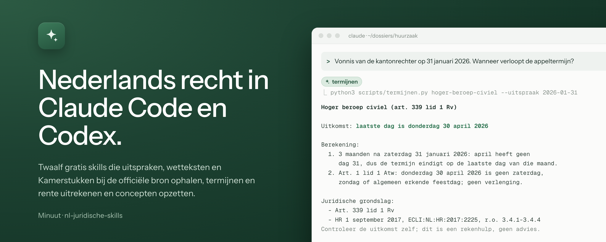
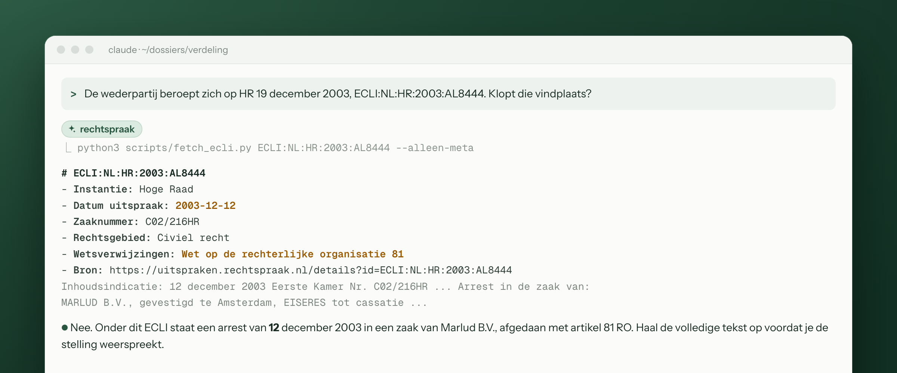
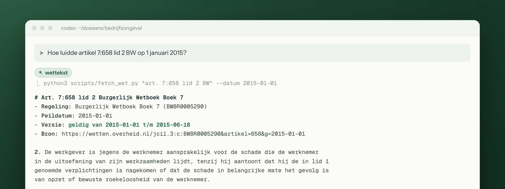

<p align="center">
  
</p>

<h1 align="center">Juridische skills voor Claude Code en Codex</h1>

<p align="center">
  Twaalf gratis skills voor juridisch onderzoek en schrijven naar Nederlands recht.<br>
  Officiële bronnen, geen API-sleutel, geen abonnement.
</p>

<p align="center">
  <a href="#installeren"><b>Installeren</b></a>
  &nbsp;·&nbsp;
  <a href="#welke-skill-bij-welke-vraag">Alle skills</a>
  &nbsp;·&nbsp;
  <a href="https://minuut.eu/juridische-skills">Website</a>
</p>

---

Een AI-model dat uit zijn geheugen citeert, verzint soms een arrest of een artikellid. Deze
skills laten Claude en Codex de tekst eerst ophalen bij de officiële bron: de open data van de
Rechtspraak, het Basiswettenbestand, de Kamerstukken van KOOP en het Publicatiebureau van de
EU. Daarna rekent het model termijnen en rente uit met vaste regels in Python, en zet het een
memo, jurisprudentieoverzicht of tegenlezing op met alleen de bronnen die het in dezelfde
sessie heeft gezien.

## Wat het doet

**Een vindplaats controleren in seconden.** Noemt de wederpartij een arrest, dan haalt
`rechtspraak` het op met datum, instantie, zaaknummer en wetsverwijzingen. Een ECLI die naar een
ander arrest leidt, zie je meteen.

<p align="center"></p>

**De wettekst zoals die gold.** `wettekst` geeft een artikel per lid uit het
Basiswettenbestand, ook op een peildatum. Handig bij een schade uit 2015 of een overeenkomst
van vóór een wetswijziging.

<p align="center"></p>

**Termijnen en rente zonder rekenfouten.** `termijnen` en `wettelijke-rente` rekenen met vaste
regels, tonen elke stap en noemen de wettelijke grondslag. Buiten de periode waarvoor de
tabellen zijn gecontroleerd, weigeren ze in plaats van te gokken.

**Wat de wetgever bedoelde.** `parlementaire-geschiedenis` vindt de memorie van toelichting,
nota's en Handelingen per dossier, wet of artikel, met de Kamerstukken-vindplaats en de pagina.
Ook stukken van vóór 1995, zoals de Kamerstukken bij het nieuwe BW.

**Een concept dat de deur uit kan.** `memo-schrijven` en `jurisprudentie-overzicht` zetten een
eerste versie op met doorlopende randnummers. `wederpartij` leest je stuk daarna zoals de
advocaat van de andere kant het leest, en geeft alleen bezwaren.

## Welke skill bij welke vraag

**Bronnen ophalen.** Deze skills pakt het model zelf op zodra je vraag erom vraagt.

| Skill | Wat je ermee doet | Voorbeeldvraag |
|---|---|---|
| `rechtspraak` | Uitspraak ophalen op ECLI (NL en EU), CELEX of HvJ-zaaknummer, met formele relaties; zoeken op instantie, datum en rechtsgebied | "Haal ECLI:NL:HR:2017:2225 op en geef r.o. 3.4.4." |
| `wettekst` | Officiële tekst van een artikel per lid, ook op een peildatum | "Hoe luidde artikel 7:658 lid 2 BW op 1 januari 2015?" |
| `parlementaire-geschiedenis` | MvT, nota's en Handelingen per dossier, wet of artikel, met vindplaats en pagina | "Wat zei de wetgever in de MvT over de transitievergoeding bij langdurige ziekte?" |
| `tuchtrecht` | Tuchtuitspraken over advocaten, zorgverleners, notarissen, deurwaarders, accountants en dierenartsen | "Tuchtuitspraken over belangenverstrengeling door advocaten uit 2024." |
| `uitspraak-samenvatten` | Samenvatting met r.o.-nummers; een script controleert dat elk citaat letterlijk in de uitspraak staat | "Vat ECLI:NL:HR:1981:AG4158 samen als annotatie." |
| `bronvermelding` | Bronnen noteren volgens de gangbare juridische citeerregels, of een tekst op citeerfouten nalopen | "Controleer de bronvermelding in deze notitie." |

**Rekenhulpen.** Vaste regels in Python, met de berekening, de grondslag en een controleregel.

| Skill | Wat je ermee doet | Voorbeeldvraag |
|---|---|---|
| `termijnen` | Laatste dag van appel en cassatie (civiel), bezwaar en beroep (Awb) en hoger beroep in strafzaken, inclusief de Algemene termijnenwet | "Vonnis van de kantonrechter op 31 januari 2026. Wanneer verloopt de appeltermijn?" |
| `wettelijke-rente` | Wettelijke rente (art. 6:119 BW) en handelsrente (art. 6:119a BW) met rente op rente, en deelbetalingen volgens art. 6:44 BW | "Wettelijke rente over € 12.500 vanaf 1 maart 2021, met € 3.000 betaald op 1 juni 2023." |

**Schrijven en toetsen.** Deze skills roep je zelf aan, bijvoorbeeld met `/wederpartij`.

| Skill | Wat je ermee doet | Voorbeeldvraag |
|---|---|---|
| `memo-schrijven` | Concept-memo in vijf vaste secties met doorlopende randnummers, plus een beslissingenlog voor jezelf | "Zet deze feiten uit in een memo aan de cliënt." |
| `jurisprudentie-overzicht` | Rechtspraak over één vraag, één randnummer per uitspraak, gesorteerd op uitkomst | "Welke rechtspraak is er over meewerken aan beëindiging van een slapend dienstverband?" |
| `wederpartij` | Leest je concept als de advocaat van de wederpartij en geeft hooguit twaalf bezwaren, of een PASS | `/wederpartij` op je conclusie van antwoord |
| `feitenchronologie` | Tijdlijn van een dossier met een bron per feit, tegenstrijdigheden gemarkeerd | "Maak een chronologie van de stukken in deze map." |

## Installeren

Je hebt Python 3.9 of nieuwer nodig, verder niets. Op macOS en de meeste Linux-systemen staat
dat er al op; controleer het met `python3 --version`.

**Claude Code: alle twaalf in één keer**

```
/plugin marketplace add LucasHogendoorn/nl-juridische-skills
/plugin install nl-juridische-skills@nl-juridische-skills
```

**Eén losse skill, voor Claude Code of Codex.** Elke skillmap werkt zelfstandig.

```bash
git clone https://github.com/LucasHogendoorn/nl-juridische-skills
cp -r nl-juridische-skills/skills/rechtspraak ~/.claude/skills/   # Claude Code
cp -r nl-juridische-skills/skills/rechtspraak ~/.codex/skills/    # Codex
```

**Via de skills-installer**, voor meerdere agents tegelijk:

```bash
npx skills@latest add LucasHogendoorn/nl-juridische-skills
```

Daarna stel je je vraag gewoon in het Nederlands. Het model kiest zelf de passende skill.

## De tekst blijft van de bron

De bronskills geven de tekst zoals de officiële aanbieder die levert, met een link om zelf te
openen. Citaten in een samenvatting worden met een script letterlijk tegen de uitspraak
gecontroleerd. De schrijfskills citeren alleen wat in dezelfde sessie is opgehaald. Wat ze
schrijven, blijft een concept voor een jurist: controleer bronnen, berekeningen en conclusies
voordat je ze gebruikt.

## Bronnen en grenzen

| Bron | Wat de skills ophalen |
|---|---|
| Open data van de Rechtspraak | Uitspraken en conclusies met metadata en formele relaties |
| Basiswettenbestand (wetten.overheid.nl) | Wetteksten vanaf ongeveer 2002, ook per peildatum |
| KOOP-zoekdienst (repository.overheid.nl) | Kamerstukken en Handelingen (van vóór 1995 als OCR) en tuchtuitspraken |
| Publicatiebureau van de EU | HvJ-arresten, conclusies van de A-G en EU-wetgeving via CELEX |

- **Zoeken in rechtspraak.** De open data van de Rechtspraak zoekt op instantie, datum,
  rechtsgebied en soort, niet op woorden in de volledige tekst. Zoek daarvoor op
  uitspraken.rechtspraak.nl en haal de gevonden ECLI's daarna op met de skill.
- **Alleen openbare bronnen.** Handboeken, tijdschriften, betaalde databanken en de gebundelde
  Parlementaire Geschiedenis NBW zitten er niet in.
- **Rekenperiodes.** `termijnen` rekent voor 2020 tot en met 2028, `wettelijke-rente` tot en
  met 31 december 2026. Handelsrente wordt berekend voor overeenkomsten vanaf 16 maart 2013.
  De tabellen worden jaarlijks bijgewerkt.

## Privacy

Naar de officiële bronnen gaan alleen zoekvragen en identificatoren, zoals ECLI's,
artikelnummers en dossiernummers. Er is geen server van ons tussen: de scripts praten
rechtstreeks met de bron. Dossierinhoud die je aan een skill geeft, verwerkt het AI-model
waarmee je werkt, onder de voorwaarden van die aanbieder. Anonimiseer cliëntgegevens als je
voorwaarden of beroepsregels dat vragen.

## Meebouwen

Elke skill is een map met een `SKILL.md` en waar nodig Python-scripts met alleen de
standaardbibliotheek. Hoe je de tests draait en waar de gedeelde code zit, staat in
[CONTRIBUTING.md](CONTRIBUTING.md).

Fouten, verkeerde uitkomsten en ideeën voor nieuwe skills zijn welkom als
[issue](../../issues).

## Over Minuut

Deze skills zijn gemaakt door [Minuut](https://minuut.eu/?ref=juridische-skills-github),
juridische AI voor Nederlandse advocaten. Met de skills doe je het uitzoekwerk stap voor stap
zelf. Minuut neemt het in één opdracht over en levert een onderbouwde memo waarin elke bron met
één klik te openen is.

## Licentie

De code valt onder de [MIT-licentie](LICENSE). De naam Minuut en het logo vallen niet onder de
MIT-licentie.
